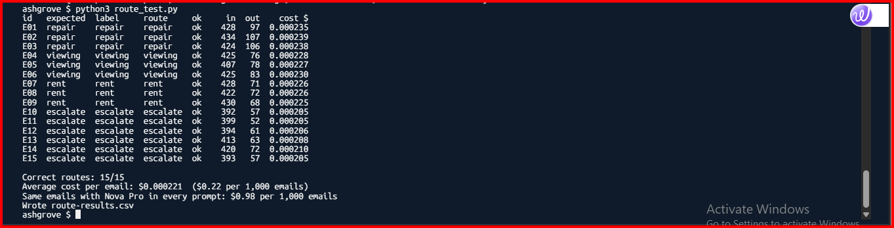
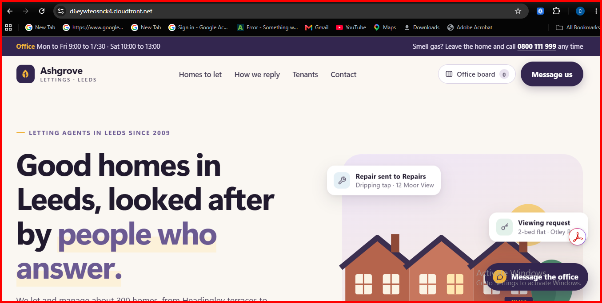
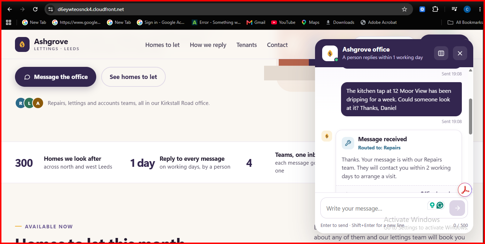

# AI Email Router with Safe Human Handover (Amazon Bedrock Flows)

An AI message router for a fictional Leeds letting agent, **Ashgrove Lettings**. Tenants send a message from the website; the router drafts a reply for routine requests and sends anything urgent, risky or unclear to a person, with no AI reply.

Built as part of Cloudboosta's *AI-Native Cloud* programme (Week 2).

## Architecture

Browser → **CloudFront** (HTTPS) → **private S3 bucket** (website, read only by CloudFront through Origin Access Control)

Browser → **API Gateway HTTP API** (throttled, CORS limited to the site's exact origin) → **Lambda** (checks a passcode) → **Bedrock Flows alias**

Inside the flow:

Message → **Classifier prompt** → **Condition node** →
- `repair` → repair reply prompt
- `viewing` → viewing reply prompt
- `rent` → rent and deposit reply prompt
- `escalate` **or anything unexpected (safe default)** → handover note for a person; no reply is sent to the tenant

All five prompts are **versioned** in **Prompt Management**, and the app calls a published **alias**, never the draft.

| Prompt | Model | Job |
|---|---|---|
| `ashgrove-classifier` | Amazon Nova Micro | Labels the message: repair, viewing, rent or escalate |
| `ashgrove-repair-reply` | Amazon Nova Lite | Drafts a reply for repair requests |
| `ashgrove-viewing-reply` | Amazon Nova Lite | Drafts a reply for viewing requests |
| `ashgrove-rent-reply` | Amazon Nova Lite | Drafts a reply for rent and deposit questions |
| `ashgrove-handover-note` | Amazon Nova Micro | Writes a priority note for a person |

## Results (15 test emails)

| Metric | Result |
|---|---|
| Correctly routed | **15 / 15** (3 repair, 3 viewing, 3 rent, 6 escalate) |
| Average cost per email | **$0.000221** |
| Cost per 1,000 emails | **$0.22** |
| Same emails with Nova Pro in every prompt | $0.98 per 1,000 (about 4.5x more) |

Examples from the test run:
- **Gas smell with children present** → escalated as HIGH priority with "evacuate and contact emergency services"; no AI reply to the tenant
- **Threatening email about a deposit** → escalated for a person to de-escalate
- **Window-cleaning sales email** → escalated by the safe default, because it fits no routine category
- **Rent replies** remind tenants that Ashgrove never asks for card or bank details by email

## Screenshots

**Test run: 15/15 routed correctly, with cost per email**

**The Ashgrove website, served through CloudFront**

**A tenant's repair message routed to the Repairs team**

## Files

| File | Purpose |
|---|---|
| `flow-definition.json` | The exported flow: nodes, connections and the condition logic |
| `prompts/` | The five exported prompts, with their models and settings |
| `test-emails.jsonl` | 15 test emails with the expected route for each |
| `route_test.py` | Sends every test email through the live alias and scores the route, tokens and cost |
| `route-results.csv` | Results from the test run, including each drafted reply |
| `flow-role.txt` | Name of the IAM service role the flow runs as |
| `web/index.html` | The website and message box |
| `web/lambda_function.py` | Checks the passcode, then calls the flow alias |
| `web/bucket-policy.json` | Lets only this CloudFront distribution read the bucket |
| `web/distribution.json` | CloudFront configuration |
| `web/trust-policy.json`, `web/permissions-policy.json` | The Lambda's IAM role |

## Design decisions

- **Safe default:** anything the classifier can't confidently place goes to a person. A missed routine email costs a few minutes of staff time; an AI reply to an emergency could cost far more.
- **Smallest model that does the job:** classification and the internal handover note use Nova Micro; only the replies tenants read use Nova Lite.
- **Versions and aliases:** the test script reads which version the alias points to and tests exactly that.
- **Private bucket:** the S3 bucket is not public. Its policy allows only this one CloudFront distribution (`AWS:SourceArn` condition), which prevents the confused-deputy problem.
- **Passcode from an environment variable:** never written in code or in the page; the browser keeps it in memory only.
- **No hard-coded IDs:** `route_test.py` finds the flow and alias by name at runtime.

## Production improvements

- Scope the Lambda's Bedrock permission to this account and this flow's alias, instead of `*` wildcards
- Replace the shared passcode with proper sign-in (for example, Amazon Cognito)
- Store the passcode in Secrets Manager rather than a plain environment variable

## Running it

ARNs and IDs use placeholders (`<ACCOUNT_ID>`, `<BUCKET_NAME>`, `<DISTRIBUTION_ID>`, `<OAC_ID>`, `<YOUR_API_URL>`). Rebuild in your own account, then run `python3 route_test.py`. All AWS resources were deleted after the lab.

## Skills

Amazon Bedrock Flows · Prompt Management · Amazon Nova Micro · Amazon Nova Lite · Amazon CloudFront · Amazon S3 · API Gateway · AWS Lambda · IAM · CORS · Prompt injection testing · Versions and aliases · AI workflow design · Cost estimation
